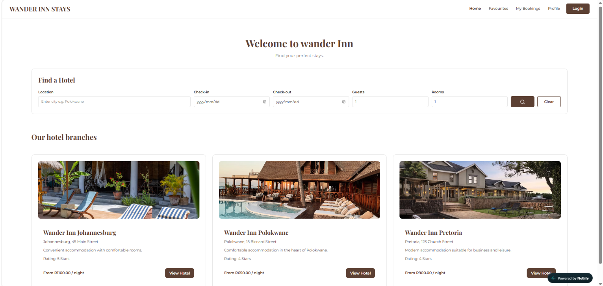
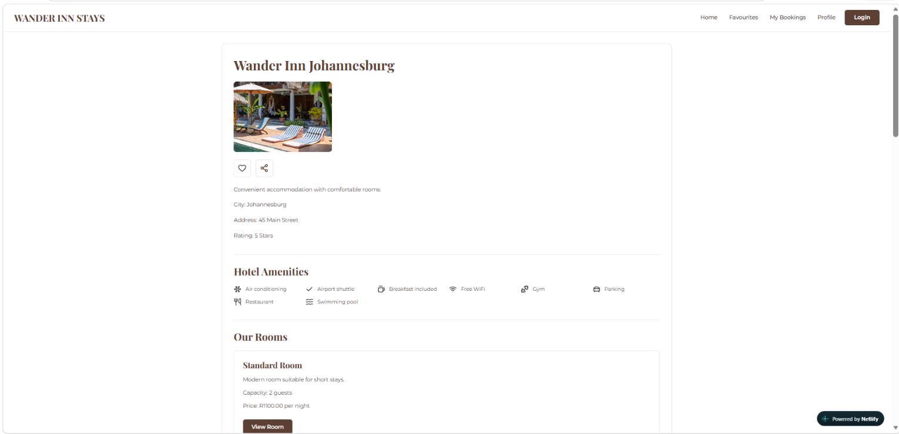
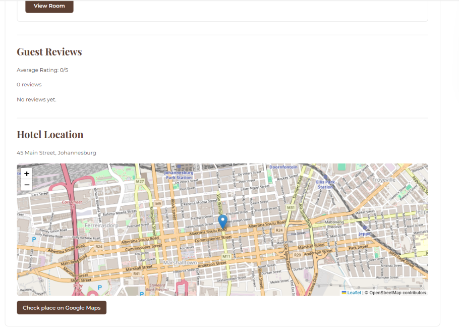
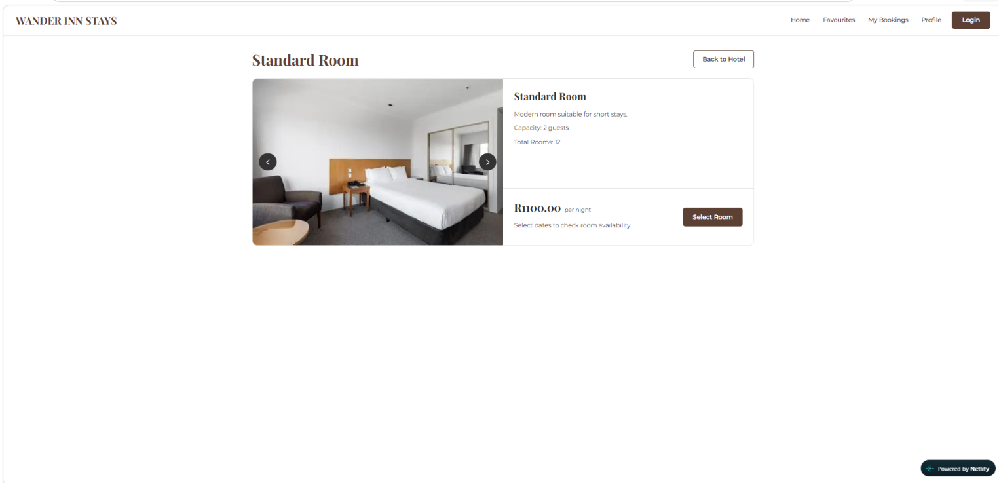
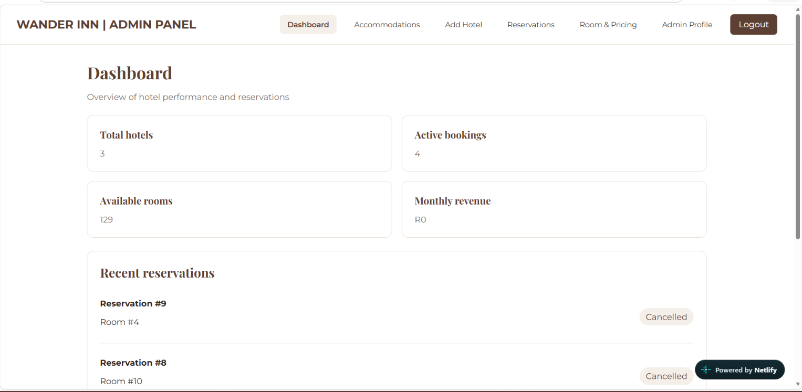

# Wander Inn - Hotel Booking App

Wander Inn is a hotel booking web application built with React, TypeScript and Vite. Users can explore hotels, view room details, register or log in, make reservations, save favourite hotels and manage their bookings. The application also includes an admin dashboard for managing hotels, rooms and reservations.

[Live App](https://wander-hotel-app.netlify.app/)

## Features

Users can:

- Register and log in using email and password or Google authentication.
- Browse hotels and view their descriptions, locations, images, amenities and policies.
- Search for hotels by city using the home page search form.
- Select check-in and check-out dates, guests and number of rooms in the booking flow.
- View hotel locations on maps.
- View room types, prices, capacity and room images.
- Make a booking after logging in.
- View booking history and individual booking details.
- Open the payment page for pending bookings and verify payments after returning from the payment provider.
- Add and remove favourite hotels.
- Submit hotel ratings and reviews.
- View notifications.
- View and edit profile information.

Admins can:

- Access an admin dashboard.
- Add, edit and delete hotels.
- Upload and manage hotel images.
- Add, edit and delete rooms and manage their images.
- View and manage bookings.
- Access the admin profile page.

## How to Use

### Browse Hotels

Open the home page to see hotel listings. Select a hotel to view its details, amenities, images and location.

### Search for a Hotel

Enter a city and select your check-in and check-out dates on the home page. You can also specify the number of guests and rooms. The current hotel listing request filters by city.

### View Rooms

Open a hotel and view its rooms. Select a room to see its price, capacity, description and images. You do not need to log in just to browse hotels and rooms.

### Register or Log In

Create an account or log in with your email and password. Google sign-in is also available. You must be logged in to make bookings and access your personal pages.

### Make a Booking

Choose a room and continue to the booking page. Enter your stay details and submit your reservation.

### Pay for a Booking

Open the payment page for a pending booking and follow the payment provider's checkout process. The application includes a payment verification page for the return from checkout.

### Manage Bookings

Open the bookings page to view your reservations and select a booking to see its details.

### Favourites and Reviews

Save hotels to your favourites and open the favourites page to view them. You can also submit a rating and review for a hotel.

### Manage Your Profile

View and edit your profile information or log out.

### Admin Dashboard

Admin users can manage hotels, rooms, images and bookings from the admin pages.

## Routes

Public routes:

- `/` - Home page and hotel listings
- `/hotels/:id` - Hotel details
- `/rooms/:id` - Room details
- `/register` - Registration page (for logged-out users)
- `/login` - Login page (for logged-out users)

Logged-in user routes:

- `/profile` - View profile
- `/profile/edit` - Edit profile
- `/bookings` - View bookings
- `/bookings/:id` - Booking details
- `/bookings/new/:roomId` - Make a booking
- `/bookings/:id/payment` - Booking payment
- `/payment/success` - Payment verification result
- `/favourites` - Favourite hotels
- `/notifications` - Notifications
- `/hotels/:hotelId/review` - Write a hotel review

Admin routes:

- `/admin` - Admin dashboard
- `/admin/hotels` - Manage hotels
- `/admin/hotels/new` - Add a hotel
- `/admin/hotels/:id/edit` - Edit a hotel
- `/admin/rooms` - Manage rooms
- `/admin/bookings` - Manage bookings
- `/admin/bookings/:id` - Admin booking details
- `/admin/profile` - Admin profile

## Tech Stack

- React and TypeScript
- Vite
- React Router DOM (routing)
- Redux Toolkit and React Redux (state management)
- Axios (backend API requests)
- Google OAuth (`@react-oauth/google`)
- Google maps
- Lucide React (icons)
- CSS (styling and responsive layouts)
- Oxlint (linting)

The frontend communicates with a separate backend API built with Express and PostgreSQL.

## Installation

### 1. Clone the Repository

Make sure you have Node.js, npm and Git installed. Open your terminal and run:

```bash
git clone https://github.com/Karabo-Merinah/Hotel-App.git
```

### 2. Navigate to the Frontend

```bash
cd Hotel-App
cd Hotel-App-Frontend
```

### 3. Install Dependencies

```bash
npm install
```

### 4. Set Up Environment Variables

Create a `.env` file in the `Hotel-App-Frontend` folder and add:

```env
VITE_API_URL=http://localhost:5000
VITE_GOOGLE_CLIENT_ID=your_google_client_id_here
```

- `VITE_API_URL` is the base URL of the backend API.
- `VITE_GOOGLE_CLIENT_ID` is the Google OAuth Client ID used for Google sign-in.


### 5. Start the Backend

Start the separate Wander Inn backend project and ensure it is available at:

`http://localhost:5000`

The backend is required for authentication, hotels, rooms, bookings and other API-based features. Follow the backend project's setup instructions to configure its database and start the API.

### 6. Start the Development Server

In the frontend folder, run:

```bash
npm run dev
```

Open the local URL shown by Vite, usually:

`http://localhost:5173`

Both the backend and frontend should be running for the complete application to work locally.

## Other Commands

Run the linter:

```bash
npm run lint
```

Build for production:

```bash
npm run build
```

Preview the production build:

```bash
npm run preview
```

## Deployment

The frontend is deployed using Netlify and connects to a backend hosted on Render.

- Frontend: https://wander-hotel-app.netlify.app/
- Backend API: https://wander-inn-backend.onrender.com/


The project includes `public/_redirects` to support React Router pages when refreshing or opening a direct URL on Netlify. The backend must allow the deployed Netlify origin in its CORS configuration.


## App Preview

### Home Page

Preview showing hotel listings and the search form.



### Hotel Details

Preview showing hotel information and images.





### Room Details

Preview showing room details and images.



### Admin Dashboard

Preview showing the admin dashboard.



### Admin credentials for testing 

## username
kaybee@gmail.com

## password 

Kayy@123 

## What I Have Learnt

- Building a multi-page React application with TypeScript and Vite.
- Using React Router to manage public, protected and admin routes.
- Managing authentication, bookings and favourites with Redux Toolkit.
- Sending API requests with Axios and handling loading and error states.
- Implementing email/password login and Google authentication in a frontend
-Using OAuth 
- Working with hotel and room image galleries.
- Displaying maps using React Leaflet.
- Building booking and payment-related user interfaces.
- Creating responsive layouts for desktop and mobile devices.
- Understanding CORS configuration when frontend and backend are hosted on different domains.

## Future Improvements

- Add advanced search filters for room price, star rating and amenities.

